<div align="center">

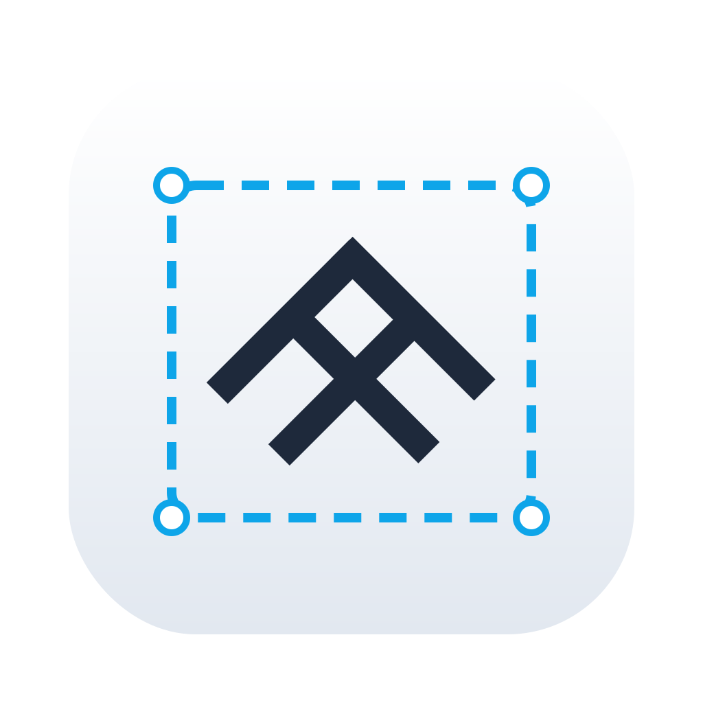

# MasterFabric Cut

**Capture, annotate and record your screen — all from the macOS menu bar.**

[](https://www.apple.com/macos/)
[](https://swift.org)
[](https://developer.apple.com/xcode/swiftui/)
[](https://github.com/masterfabric/masterfabric-cut/releases/latest)
[](LICENSE)
[](#built-with-grok-bot)

[**⬇️ Download DMG**](https://github.com/masterfabric/masterfabric-cut/releases/latest) ·
[Features](#features) ·
[Screenshots](#screenshots) ·
[Installation](#installation) ·
[Changelog](CHANGELOG.md) ·
[License](#license)

</div>

---

MasterFabric Cut is a native, lightweight menu bar app for taking beautiful screenshots, marking them up and recording your screen.
Grab an area, a window or the whole display, polish it in a built-in editor with window frames and backgrounds, pin it above your other windows,
or record a screen/GIF with a webcam bubble in **Recording Studio**. Everything is stored locally; nothing leaves your Mac.

## Screenshots

<table>
  <tr>
    <td align="center" width="33%">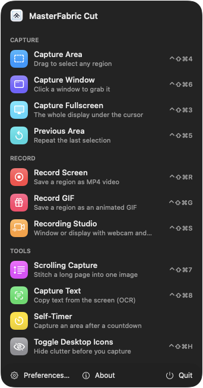<br/><sub><b>Menu bar panel</b></sub></td>
    <td align="center" width="67%">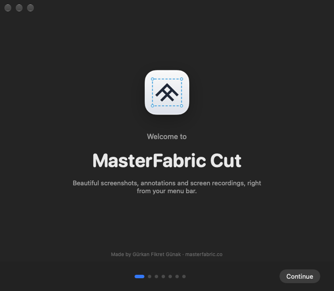<br/><sub><b>Onboarding &amp; permissions</b></sub></td>
  </tr>
</table>

### Annotation editor with window styles

<table>
  <tr>
    <td align="center">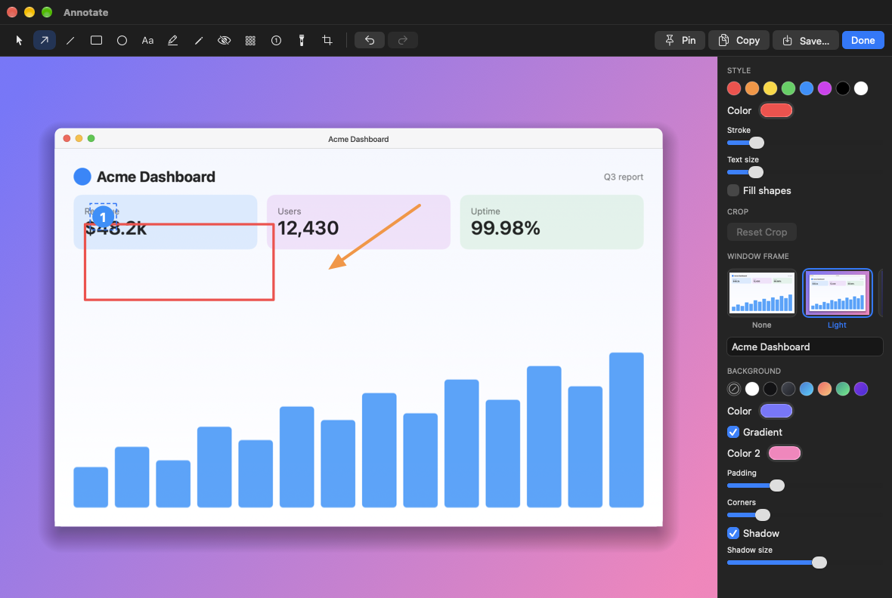<br/><sub>macOS frame</sub></td>
    <td align="center">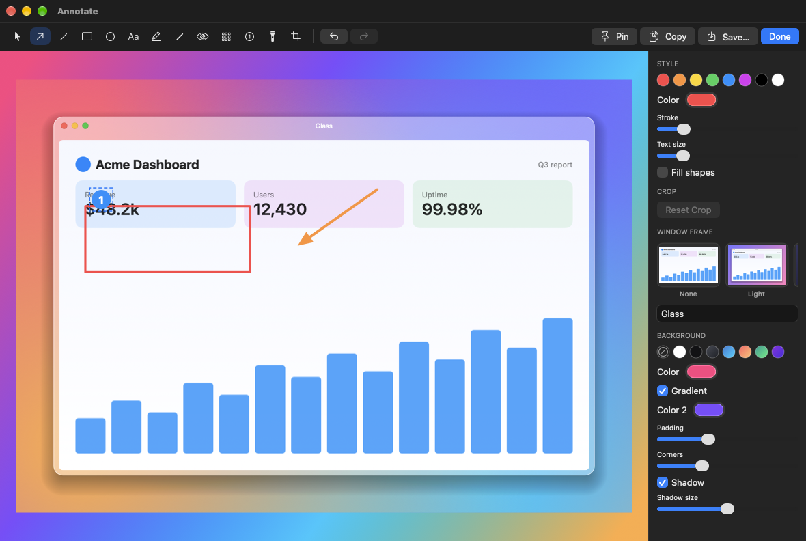<br/><sub>Glass on a mesh gradient</sub></td>
  </tr>
  <tr>
    <td align="center" colspan="2">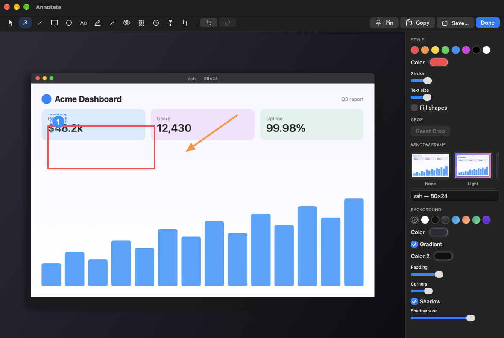<br/><sub>Terminal frame</sub></td>
  </tr>
</table>

### Capture History, player and recording

<table>
  <tr>
    <td align="center" width="62%">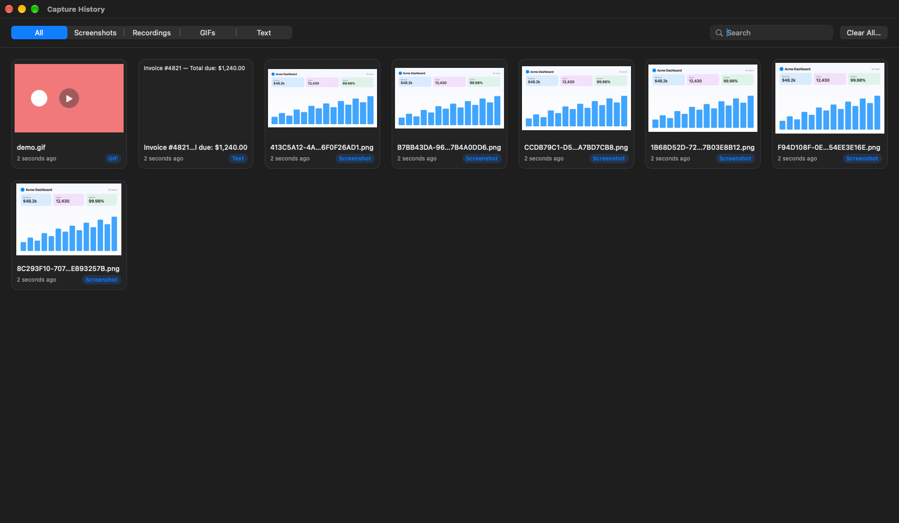<br/><sub><b>Capture History</b></sub></td>
    <td align="center" width="38%">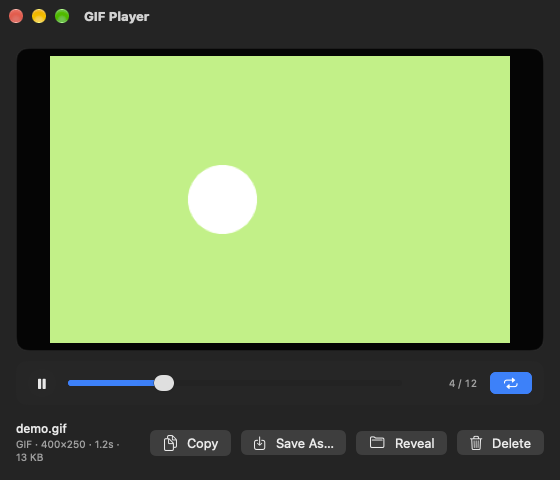<br/><sub><b>GIF / video player</b></sub></td>
  </tr>
  <tr>
    <td align="center">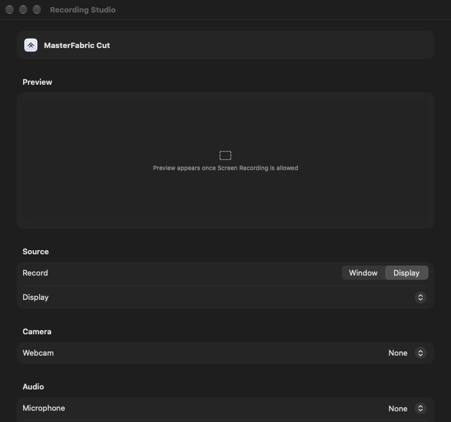<br/><sub><b>Recording Studio</b></sub></td>
    <td align="center">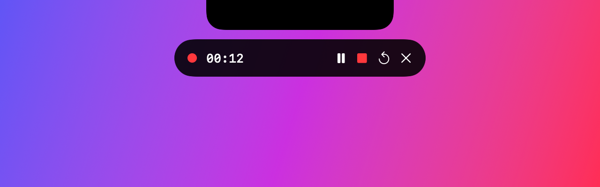<br/><sub><b>Controls pill below the notch</b></sub></td>
  </tr>
  <tr>
    <td align="center">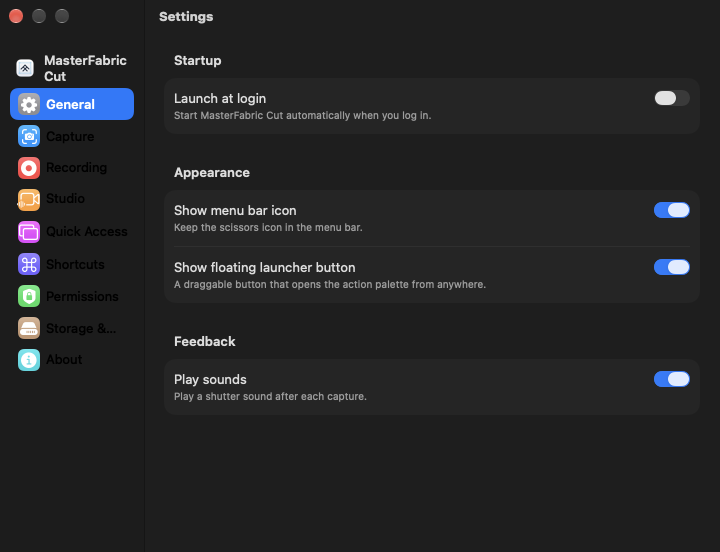<br/><sub><b>Settings</b></sub></td>
    <td align="center">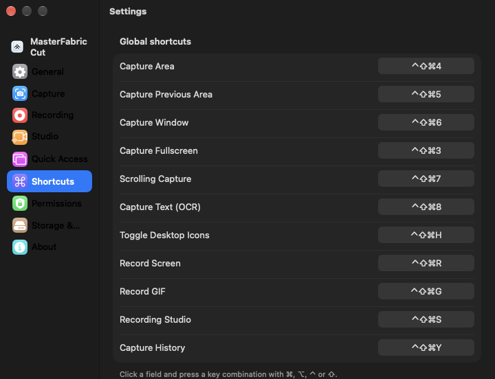<br/><sub><b>Configurable shortcuts</b></sub></td>
  </tr>
</table>

## Who it's for

- **Developers** – bug reports, PR descriptions and docs with annotated screenshots, OCR to copy text out of any window, terminal-style frames.
- **Designers** – polished presentation shots with gradient/mesh backdrops, padding, corner radius and shadows.
- **Educators** – narrated screen recordings with a webcam bubble, click and keystroke overlays, and a focus dim around the recorded area.
- **Support teams** – quick scrolling captures, arrows, blur for sensitive data, and GIFs that show the steps.
- **Content creators** – Recording Studio sessions, MP4/GIF export and a searchable capture history.

## Features

### Capture
- Area, window and fullscreen capture with a crosshair, magnifier and live dimensions
- Repeat the previous area
- Scrolling capture that stitches a long page into one image
- OCR text capture (Apple Vision) straight to the clipboard
- Self-timer capture
- Toggle desktop icons before you shoot

### Annotate
- Tools: arrow, line, rectangle, ellipse, text, highlighter, pencil, blur, pixelate, numbered steps, spotlight and crop
- Undo/redo, adjustable color, stroke, text size and fill
- **Window Frame styles** with live thumbnail swatches: macOS Light, macOS Dark, Safari-style browser, Minimal, Glass (mesh gradient) and Terminal
- Backgrounds: preset chips, custom colors, gradients, padding, corner radius, shadow size and window title text
- One render path, so the preview matches the exported/copied image

### Pin to screen
- Pin any screenshot (or the clipboard image) as a floating, always-on-top window
- Scale it, and close it from its context menu

### Quick Access overlay
- Stacked, rounded preview cards after every capture or recording
- Copy, Save, Annotate, Pin and Close actions, drag-out into other apps
- Auto-dismiss timer that pauses on hover; position is configurable

### Recording Studio
- Record a window or a display, with microphone and system audio
- Draggable, resizable **webcam bubble** (circle/square, mirror, layouts) with a live preview
- Click and keystroke overlays, countdown
- **Focus dim**: everything outside the recorded area or window is darkened (adjustable strength)
- **Notch-aware controls** pill: timer, pause/resume, stop, restart and cancel, centered under the notch (or the menu bar); excluded from the video
- Exact pause timing, plus MP4 or GIF export and a trim editor

### Capture History
- Screenshots, recordings, GIFs and OCR text in one searchable, filterable grid
- Hover GIF previews, play badges and durations
- Built-in **GIF/video player** with play/pause, loop, frame scrubber, Copy, Save As, Reveal in Finder and Delete
- Pin, copy, annotate and drag items to other apps

### Local-first storage
- Preferences, onboarding state and history metadata live in a local **SQLite** database in `~/Library/Application Support/MasterFabric Cut/`
- No accounts, no cloud, no telemetry

### Onboarding & permissions
- Welcome flow with live permission status for Screen Recording, Camera, Microphone and Accessibility, plus tips and tricks
- Friendly permission sheets with deep links to System Settings and a one-click app relaunch
- Optional floating launcher button with an action palette, and launch at login

## Tech stack

| Area | Technology |
|---|---|
| Language | Swift 5.9 |
| UI | SwiftUI + AppKit |
| Screen capture & recording | ScreenCaptureKit |
| Media, camera, audio, GIF/MP4 | AVFoundation, ImageIO |
| OCR | Vision |
| Storage | SQLite (system SQLite3) |
| Project generation | XcodeGen |

## Installation

### From the DMG
1. Download the latest DMG from the [Releases page](https://github.com/masterfabric/masterfabric-cut/releases/latest).
2. Open it and drag **MasterFabric Cut** into **Applications**.
3. The app is not signed or notarized yet, so macOS may block the first launch. Either right-click the app › **Open**, or run:
   ```sh
   xattr -cr "/Applications/MasterFabric Cut.app"
   ```
4. Grant **Screen Recording** (and optionally **Camera**, **Microphone** and **Accessibility**) when asked, in System Settings › Privacy & Security.
5. **Relaunch the app after granting Screen Recording**; macOS only applies it to a fresh process. The permission window has a *Restart MasterFabric Cut* button.

> Builds are ad-hoc signed, so macOS may ask you to re-grant permissions after an update. To reset a stale entry: `tccutil reset ScreenCapture com.masterfabric.cut`.

### Build from source
Requires macOS 14+, Xcode and [XcodeGen](https://github.com/yonaskolb/XcodeGen).

```sh
brew install xcodegen          # once
xcodegen generate              # creates MasterFabricCut.xcodeproj from project.yml
xcodebuild -project MasterFabricCut.xcodeproj -scheme MasterFabricCut \
  -configuration Release -derivedDataPath build build
open "build/Build/Products/Release/MasterFabric Cut.app"
```

## Keyboard shortcuts

Global defaults (all rebindable in Settings › Shortcuts). They use ⌃⇧⌘ to avoid clashing with the system ⇧⌘3/4/5.

| Action | Shortcut |
|---|---|
| Capture Fullscreen | `⌃⇧⌘3` |
| Capture Area | `⌃⇧⌘4` |
| Capture Previous Area | `⌃⇧⌘5` |
| Capture Window | `⌃⇧⌘6` |
| Scrolling Capture | `⌃⇧⌘7` |
| Capture Text (OCR) | `⌃⇧⌘8` |
| Toggle Desktop Icons | `⌃⇧⌘H` |
| Record Screen | `⌃⇧⌘R` |
| Record GIF | `⌃⇧⌘G` |
| Recording Studio | `⌃⇧⌘S` |
| Capture History | `⌃⇧⌘Y` |

## Project layout

| Path | Contents |
|---|---|
| `Sources/App` | App entry, menu bar panel, onboarding, floating launcher, Settings, About |
| `Sources/Shared` | Settings, permissions, SQLite storage, utilities |
| `Sources/Modules/Capture` | Area/window/fullscreen capture, scrolling, OCR, timer, hotkeys |
| `Sources/Modules/Annotate` | Editor, Quick Access, pins, history and media player |
| `Sources/Modules/Recording` | Recording engine, Studio, webcam bubble, controls, trim, export |

## Creator

Created by **Gürkan Fikret Günak** at [MasterFabric](https://masterfabric.co) · X: [@gurkandev](https://x.com/gurkandev)

## Built with Grok Bot

[](#built-with-grok-bot)

Developed with **Grok Bot** and **Claude Code**.

## License

Released under the [GNU Affero General Public License v3.0](LICENSE). Copyright © 2026 Gürkan Fikret Günak, MasterFabric ([masterfabric.co](https://masterfabric.co)).

See also [CONTRIBUTING.md](CONTRIBUTING.md), [CODE_OF_CONDUCT.md](CODE_OF_CONDUCT.md) and [SECURITY.md](SECURITY.md).
